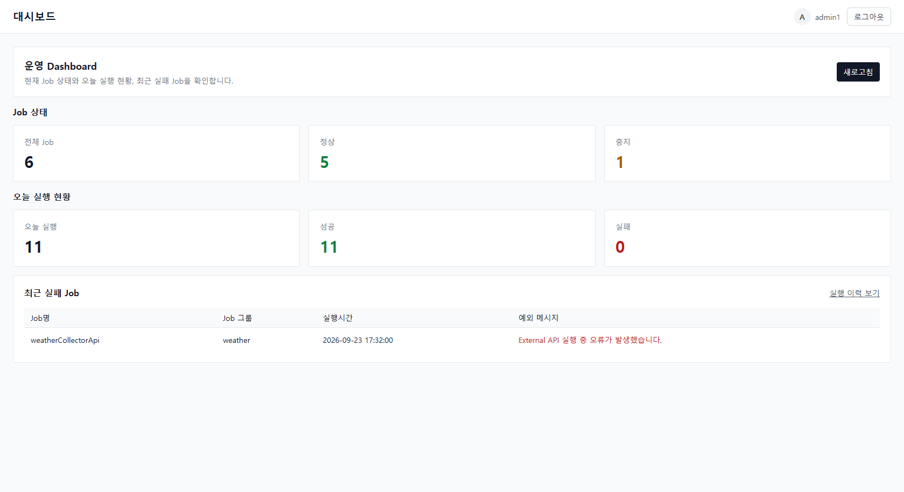
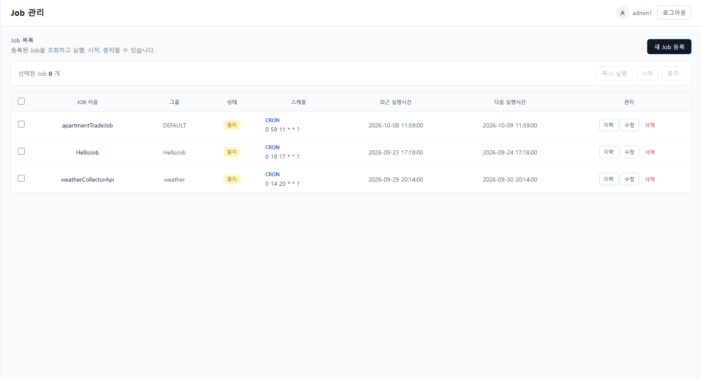
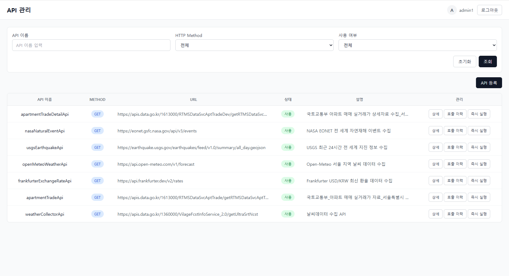

# Scheduler UI

Vue 3 기반의 Dynamic Scheduler 관리자 웹 애플리케이션입니다.

Spring Boot와 Quartz 기반의 백엔드 REST API와 연동하여 동적 스케줄 관리, 외부 API 데이터 수집, JSON/XML 데이터 가공 및 AI 데이터 분석 기능을 웹 화면에서 사용할 수 있습니다.

Job과 Trigger의 실행 상태를 조회하고, 외부 API 호출 이력부터 Raw Data, 가공 작업 및 결과까지 확인할 수 있습니다.

Spring Security의 세션 인증과 연동하며, Pinia를 이용한 사용자 인증 상태 관리 및 역할별 화면 접근 제어를 지원합니다.

---

## Features

### Dashboard & Scheduler Monitoring

스케줄러의 실행 상태와 운영 정보를 조회합니다.

- 대시보드를 통한 스케줄 실행 현황 확인
- Quartz Scheduler 상태 및 운영 정보 조회
- Job 실행 이력 및 상태별 조회

### Job Management

Quartz Job과 Trigger를 웹 화면에서 관리합니다.

- Job 등록, 조회, 수정, 삭제
- Job 즉시 실행, 중지 및 재개
- 여러 Job 일괄 실행, 중지 및 재개
- CRON / SIMPLE 스케줄 설정
- Misfire 정책 및 실행 파라미터 관리
- Job 실행 상태 및 이력 조회

### External API Management

외부 API의 호출 설정과 데이터 수집 이력을 관리합니다.

- 외부 API 등록, 조회, 수정, 삭제
- HTTP Method 및 인증정보 설정
- Header / Query / Body 파라미터 관리
- 날짜·시간 기반 동적 파라미터 및 오프셋 설정
- LIST / RANGE 기반 반복 파라미터 설정
- 재시도 및 페이징 설정
- 외부 API 즉시 실행
- 실행 이력 및 HTTP 호출 결과 조회
- 실제 요청 파라미터 및 재시도 상세 정보 조회

### Raw Data Management

외부 API를 통해 수집된 원본 데이터를 조회합니다.

- Raw Data 목록 및 상세 조회
- JSON/XML 응답 데이터 확인
- JSON 데이터 트리 뷰어
- 수집 이력 및 호출 정보 연계 조회
- Raw Data별 가공 상태 확인

### Data Transformation

JSON/XML 데이터 가공 규칙과 처리 결과를 관리합니다.

- 가공 규칙 등록 및 조회
- 가공 규칙 버전 및 필드 설정
- JSONPath / XPath 기반 데이터 추출 설정
- 필드 타입 및 기본값 설정
- 샘플 데이터 기반 가공 결과 미리보기
- 가공 대상 및 작업 상태 조회
- 가공 결과 목록 및 상세 조회

### AI Data Analysis

가공된 데이터를 대상으로 AI 분석 기능을 제공합니다.

- 외부 API 및 가공 규칙별 분석 대상 선택
- 가공 규칙 버전 및 조회 기간 설정
- 데이터셋 정보 및 필드 메타데이터 조회
- 가공 데이터 목록 및 미리보기
- 자연어 기반 AI 데이터 분석 요청
- AI 분석 결과 표시

### Authentication & Authorization

Spring Security 기반 인증과 사용자 권한에 따른 화면 접근을 관리합니다.

- 로그인 및 로그아웃
- 회원가입 활성화 여부에 따른 화면 접근 제어
- Pinia 기반 로그인 사용자 상태 관리
- ADMIN / USER 역할 기반 접근 제어
- 관리자 전용 등록, 수정 및 실행 기능 제어
- 미인증 사용자 로그인 화면 이동

## Screenshots

### Dashboard



### Job Management



### External API Management



## Tech Stack

### Frontend

| Technology   | Version / Description |
| ------------ | --------------------- |
| Vue.js       | 3                     |
| Vite         | 7                     |
| JavaScript   | ES Modules            |
| Vue Router   | 4                     |
| Pinia        | 4                     |
| Axios        | HTTP Client           |
| Tailwind CSS | 3                     |

### Development Tools

| Technology   | Description     |
| ------------ | --------------- |
| ESLint       | Code Linting    |
| Prettier     | Code Formatting |
| Vue DevTools | Vue Debugging   |

## Getting Started

### Prerequisites

로컬 환경에서 애플리케이션을 실행하려면 다음 항목이 필요합니다.

- Node.js 20.19.0 이상(20.x) 또는 22.12.0 이상
- npm
- Git
- 실행 중인 Scheduler Backend

백엔드 설치 및 실행 방법은 [spring-quartz-scheduler](https://github.com/ideale17/spring-quartz-scheduler)를 참고하세요.

### 1. Clone Repository

```bash
git clone https://github.com/ideale17/scheduler-ui.git
cd scheduler-ui
```

### 2. Install Dependencies

프로젝트 의존성을 설치합니다.

```bash
npm install
```

### 3. API Configuration

프론트엔드는 환경변수 `VITE_API_BASE_URL`을 통해 백엔드 API 주소를 설정합니다.

로컬 개발 환경에서는 `.env.development` 파일에 다음 값이 설정되어 있습니다.

```properties
VITE_API_BASE_URL=http://localhost:8080
```

백엔드 애플리케이션이 `http://localhost:8080`에서 실행 중이어야 합니다.

운영 환경에서는 `.env.production`에 다음 값이 설정되어 있습니다.

```properties
VITE_API_BASE_URL=/api
```

운영 환경에서는 `/api` 경로를 통해 백엔드 API에 접근하도록 구성되어 있습니다.

### 4. Run Development Server

개발 서버를 실행합니다.

```bash
npm run dev
```

기본 접속 주소:

```text
http://localhost:5173
```

로그인 및 데이터 조회 기능을 사용하려면 백엔드 서버가 실행 중이어야 합니다.

### 5. Production Build

프로덕션 빌드를 실행합니다.

```bash
npm run build
```

빌드 결과는 `dist/` 디렉터리에 생성됩니다.

## Project Structure

```text
scheduler-ui/
├── public/                  # 정적 리소스
├── src/
│   ├── api/                 # 백엔드 REST API 연동
│   ├── components/          # 공통 UI 컴포넌트
│   ├── layouts/             # 공통 화면 레이아웃
│   ├── pages/               # 주요 기능별 화면
│   ├── router/              # Vue Router 및 접근 제어
│   ├── stores/              # Pinia 상태 관리
│   ├── styles/              # 공통 스타일
│   ├── utils/               # 공통 유틸리티
│   ├── App.vue              # 최상위 Vue 컴포넌트
│   └── main.js              # 애플리케이션 진입점
├── docs/                    # 프로젝트 문서 및 스크린샷
├── .env.development         # 개발 환경 API 설정
├── .env.production          # 운영 환경 API 설정
├── package.json             # 의존성 및 npm 스크립트
├── vite.config.js           # Vite 설정
├── tailwind.config.js       # Tailwind CSS 설정
└── README.md
```

---

## Related Repositories

- [spring-quartz-scheduler](https://github.com/ideale17/spring-quartz-scheduler) — Spring Boot 및 Quartz 기반 백엔드 애플리케이션

---

## Demo

https://scheduler.pomibori.dev/
