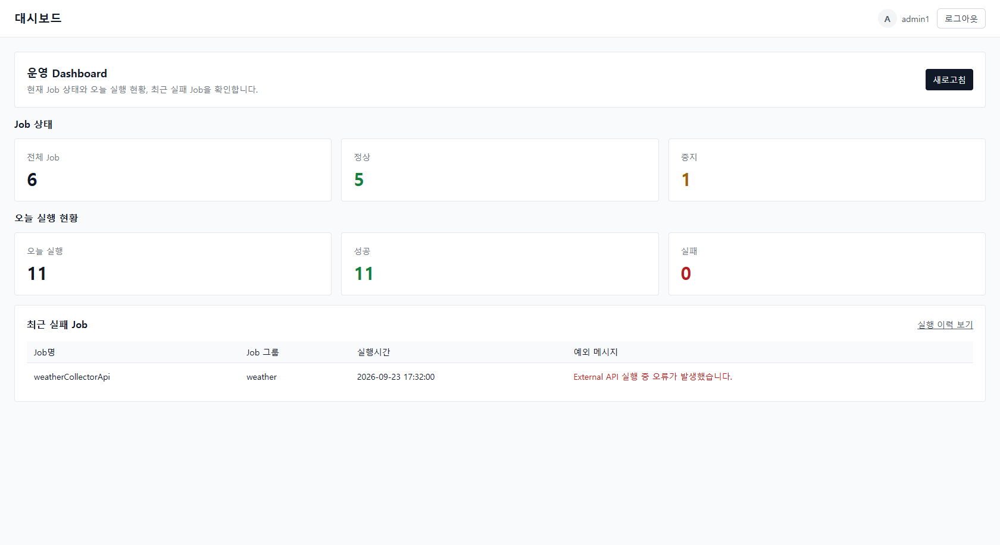
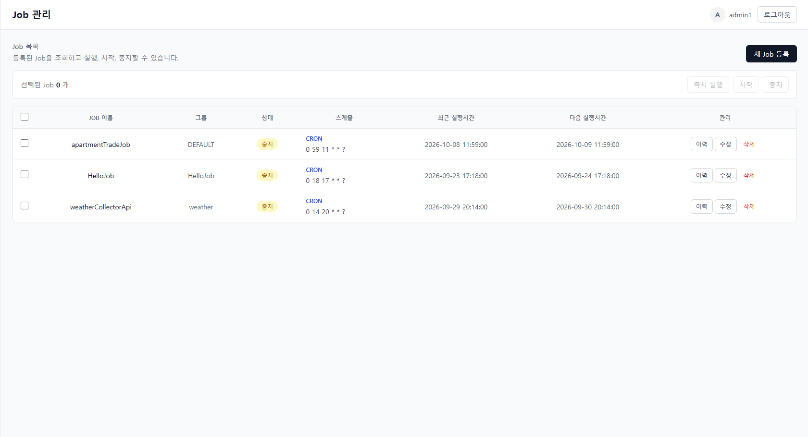
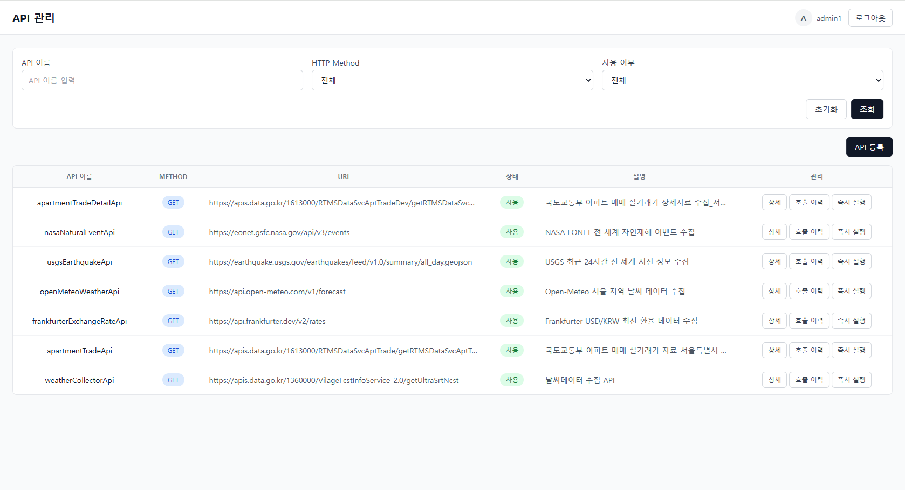

# Scheduler UI

Vue 3 기반의 Dynamic Scheduler 관리자 웹 애플리케이션입니다.

Spring Boot와 Quartz 기반의 백엔드 REST API와 연동하여 동적 스케줄 관리, 외부 API 데이터 수집, JSON/XML 데이터 가공 및 AI 데이터 분석 기능을 웹 화면에서 사용할 수 있습니다.

Job과 Trigger의 실행 상태를 조회하고, 외부 API 호출 이력부터 Raw Data, 가공 작업 및 결과까지 확인할 수 있습니다.

Spring Security의 세션 인증과 연동하며, Pinia를 이용한 사용자 인증 상태 관리 및 역할별 화면 접근 제어를 지원합니다.

---

## Features

### Dashboard & Scheduler Monitoring

- 대시보드에서 Quartz 스케줄러 상태와 Job 실행 현황 확인

### Job Management

- Job 등록·수정·삭제 및 실행 제어
- CRON / SIMPLE 스케줄, Misfire 정책 및 실행 파라미터 설정

### External API Management

- 외부 API 요청, 인증, 파라미터 설정
- 반복 호출, 재시도 및 페이징 설정
- API 실행 이력과 요청·응답 확인

### Raw Data Management

- 수집한 Raw Data 목록과 JSON/XML 원본 조회
- Raw Data별 수집 이력과 가공 상태 확인

### Data Transformation

- JSON/XML 가공 규칙과 버전 관리
- 샘플 데이터로 가공 결과 미리보기
- 가공 대상, 작업 상태 및 결과 조회

### Data Loading

- 데이터 적재 모델 및 필드 매핑 관리
- 적재 상태별 대상 조회 및 적재 작업 등록
- 적재된 데이터 조회

### AI Data Analysis

가공 데이터를 선택해 자연어로 분석을 요청하고 응답을 확인하는 기본 흐름을 구현했습니다. 현재는 초기 구현 단계입니다.

### Authentication & Authorization

Spring Security 세션 인증과 사용자 역할에 따라 화면 접근 및 작업 권한을 관리합니다.

- 로그인·로그아웃 및 게스트 로그인
- ADMIN / USER / GUEST 역할별 화면 접근 제어
- 게스트에게 허용된 화면의 읽기 전용 조회
- 관리자 전용 등록·수정·실행 기능 제어
- 회원가입 설정에 따른 접근 제어 및 미인증 사용자 로그인 화면 이동
- Pinia 기반 로그인 사용자 상태 관리

## Screenshots

### Dashboard



### Job Management



### External API Management



## Tech Stack

### Frontend

| Technology   | Version / Description |
| ------------ | --------------------- |
| Vue.js       | 3                     |
| Vite         | 7                     |
| JavaScript   | ES Modules            |
| Vue Router   | 4                     |
| Pinia        | 4                     |
| Axios        | HTTP Client           |
| Tailwind CSS | 3                     |

### Development Tools

| Technology   | Description     |
| ------------ | --------------- |
| ESLint       | Code Linting    |
| Prettier     | Code Formatting |
| Vue DevTools | Vue Debugging   |

## Getting Started

### Prerequisites

로컬 환경에서 애플리케이션을 실행하려면 다음 항목이 필요합니다.

- Node.js 20.19.0 이상(20.x) 또는 22.12.0 이상
- npm
- Git
- 실행 중인 Scheduler Backend

백엔드 설치 및 실행 방법은 [spring-quartz-scheduler](https://github.com/ideale17/spring-quartz-scheduler)를 참고하세요.

### 1. Clone Repository

```bash
git clone https://github.com/ideale17/scheduler-ui.git
cd scheduler-ui
```

### 2. Install Dependencies

프로젝트 의존성을 설치합니다.

```bash
npm install
```

### 3. API Configuration

프론트엔드는 환경변수 `VITE_API_BASE_URL`을 통해 백엔드 API 주소를 설정합니다.

로컬 개발 환경에서는 `.env.development` 파일에 다음 값이 설정되어 있습니다.

```properties
VITE_API_BASE_URL=http://localhost:8080
```

백엔드 애플리케이션이 `http://localhost:8080`에서 실행 중이어야 합니다.

운영 환경에서는 `.env.production`에 다음 값이 설정되어 있습니다.

```properties
VITE_API_BASE_URL=/api
```

운영 환경에서는 `/api` 경로를 통해 백엔드 API에 접근하도록 구성되어 있습니다.

### 4. Run Development Server

개발 서버를 실행합니다.

```bash
npm run dev
```

기본 접속 주소:

```text
http://localhost:5173
```

로그인 및 데이터 조회 기능을 사용하려면 백엔드 서버가 실행 중이어야 합니다.

### 5. Production Build

프로덕션 빌드를 실행합니다.

```bash
npm run build
```

빌드 결과는 `dist/` 디렉터리에 생성됩니다.

## Project Structure

```text
scheduler-ui/
├── .github/
│   └── workflows/           # 프론트엔드 CI
├── public/                  # 파비콘 등 정적 리소스
├── src/
│   ├── api/                 # Axios 공통 설정 및 백엔드 API 호출
│   ├── components/          # 공통 UI 컴포넌트
│   ├── layouts/             # 공통 화면 레이아웃
│   ├── pages/               # 기능별 화면
│   ├── router/              # 라우팅 및 화면 접근 제어
│   ├── stores/              # Pinia 인증·알림 상태
│   ├── styles/              # 전역 스타일
│   ├── utils/               # 공통 유틸리티
│   ├── App.vue              # 최상위 Vue 컴포넌트
│   └── main.js              # 애플리케이션 진입점
├── docs/
│   ├── agents/              # AI 에이전트 작업 설정
│   └── images/              # README 화면 캡처
├── .env.development         # 개발 환경 설정
├── .env.production          # 운영 환경 설정
├── AGENTS.md                # 프로젝트 개발 및 AI 작업 규칙
├── Dockerfile               # 프론트엔드 컨테이너 빌드 설정
├── nginx.conf               # 웹 서버 설정
├── index.html               # Vite HTML 진입점
├── package.json             # 의존성 및 npm 스크립트
├── package-lock.json        # 의존성 버전 잠금
├── vite.config.js           # Vite 설정
├── tailwind.config.js       # Tailwind CSS 설정
├── postcss.config.js        # PostCSS 설정
├── eslint.config.js         # ESLint 설정
├── .prettierrc.json         # Prettier 설정
└── README.md
```

---

## Related Repositories

- [spring-quartz-scheduler](https://github.com/ideale17/spring-quartz-scheduler) — Spring Boot 및 Quartz 기반 백엔드 애플리케이션

---

## Demo

https://scheduler.pomibori.dev/
